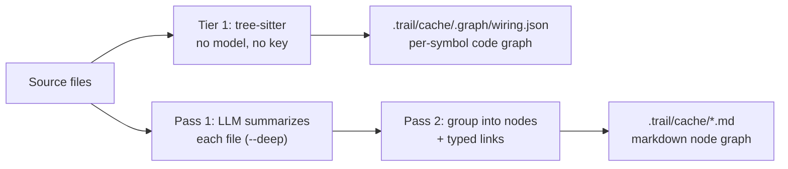

<div align="center">

<picture>
  <source media="(prefers-color-scheme: dark)" srcset="assets/trail-code-banner-dark.png">
  
</picture>

### A code map for your coding agents.

Trail-code parses a repository with tree-sitter into a graph of every file, function and caller, and serves that graph to Claude Code, Cursor, Codex and other coding agents over the CLI or MCP. No model, no API key, no network: a build is deterministic and costs nothing. An optional local semantic index covers the prose — specs, docs, system cards — the call graph can't answer for.

Tells your agent *where* things are. It does not tell it *why* — that is your repository's job, and this fork leaves it there.

<p>
  <a href="https://github.com/jastorgalj/Trail-Code"></a>
  <a href="https://nodejs.org"></a>
  
  
  <a href="TELEMETRY.md"></a>
</p>

```bash
npm install -g trail-code && trail init
```

</div>

> [!NOTE]
> **This is a fork.** It keeps upstream's code map and drops everything around it that wrote to git on its own: **no learnings, no notes, no team/cloud, no hooks, no statusline, no automatic branches or pushes.** `trail` only reads git. Durable context here lives in OpenSpec (`openspec/specs/` and `openspec/changes/`), reviewed by a human — and indexed as markdown nodes, so `trail ask` still finds it.
>
> What the fork adds on top of upstream (semantic search, the `grep` fix, workspace viz, worktree seeding) is listed with `file:line` evidence in [FORK.md](FORK.md).

---

## What changes in your agent

| Without Trail-code | With Trail-code |
|---|---|
| Greps and opens file after file to find the code it needs | Gets the right files and functions with your prompt |
| Guesses how the code is wired, and misses the caller two directories away | Sees who calls what, and what a change can break, before editing |
| Rebuilds a picture of the codebase it mapped an hour ago | Starts from a graph that is already there, and correct |
| Reads a whole file to learn one thing | Reads the crux: the lines that carry the logic, inlined at the hit |
| Answers about today's code from a stale index | Every query refreshes the graph against the working tree first |

---

## Contents

- [How Trail-code works](#how-trail-code-works)
- [Quick start](#quick-start)
- [The map](#the-map)
- [What stays on your machine](#what-stays-on-your-machine)
- [FAQ](#faq)
- Reference: [How the graph gets built](#how-the-graph-gets-built) · [Supported languages](#supported-languages) · [What's in a node](#whats-in-a-node) · [What runs where](#what-runs-where) · [Agent integration](#agent-integration) · [MCP server](#mcp-server) · [CLI](#cli) · [Search & orient](#search--orient-trail-grep--trail-map) · [Monorepos](#monorepos-submodules--multi-repo-folders) · [Worktrees](#worktrees) · [Visualize it](#visualize-it-trail-viz) · [Semantic search](#semantic-search) · [What is on disk](#what-is-on-disk) · [Environment](#environment)
- [Contributing](#contributing) · [License](#license)

---

## How Trail-code works

Trail-code has one part, and it runs on your machine.

**The map: your code.** `trail init` parses your repo with tree-sitter into a graph of every file, function and who calls what. No model, no API key, no network. Every query checks the working tree first and rebuilds only what changed, so answers describe the code as it is right now — uncommitted edits included. Your agent gets pointers to the matching files and functions with each prompt, and can trace what depends on a symbol before it touches it.

The map tells your agent *where* things are. Everything else — what the team decided, why the code is the way it is — stays in your repository, in files a human reviewed.

---

## Quick start

```bash
npm install -g trail-code     # install the CLI, once
trail init                    # in your repo: build the map, create .trail/, wire your agents
```

That is the whole setup. `trail init` asks which of your coding agents to wire up, builds the map from your code, and creates `.trail/` for the repo's cache. No daemon, no server, nothing to babysit: it is all files.

> [!TIP]
> **`npm install -g` says EACCES?** Your Node's global folder needs sudo. Skip sudo, or every upgrade will need it too: run `mkdir -p ~/.npm-global && npm config set prefix ~/.npm-global`, add `~/.npm-global/bin` to your `PATH`, open a new terminal and install again. Trail needs Node 22.3 or newer (20.16 works too).

> [!TIP]
> **CUDA 13 machine and the install dies in `onnxruntime-node`'s postinstall?** That build ships binaries only for older CUDA. Skip its GPU download; the semantic index runs on CPU: `ONNXRUNTIME_NODE_INSTALL_CUDA=skip npm i -g trail-code`. [`CONTRIBUTING.md`](CONTRIBUTING.md#cuda-13-and-the-onnxruntime-postinstall) has the long version and a fallback.

Commit the wiring so your teammates get it too. The map itself, in `.trail/cache/`, is a local cache like `node_modules` and is gitignored, so it stays out of the commit:

```bash
git add .trail .gitignore        # plus AGENTS.md, if you wired Hermes
git commit -m "set up trail-code"
```

`trail init --dry-run` prints the plan, but the plan is inherited from upstream and still lists the hook, statusline and `.claude/settings.json` writes this fork no longer does — the run writes none of them (see the note below). `trail init --agents claude` wires Claude Code alone.

---

## The map

Without a map, your coding agent starts every task blind. It greps a term, opens a file, follows an import, backs out and tries again, rebuilding a picture of a codebase it mapped an hour ago and threw away. That rediscovery burns most of a run's tool calls, tokens and time. People onboard to a codebase once. Agents onboard every single time.

The map builds that understanding once, and keeps it current:

- **Every file, function and caller.** Parsed with tree-sitter into a graph of symbols and who calls what. Deterministic, no model, no network, 24 languages.
- **The right code with every prompt.** The skill file `init` writes tells the agent to run `trail ask` before it greps or opens a file; Hermes gets the same instruction in an `AGENTS.md` section. Any agent that can run a command or speak MCP gets the same map.
- **Always fresh.** Every query checks the working tree first (a few tens of milliseconds when nothing moved) and rebuilds only what changed, so answers describe the code as it is right now, uncommitted edits included.
- **Plain files you can read.** Linked markdown nodes your agent opens and greps like any other file. No embeddings needed for the code itself, no index to keep warm.
- **Summaries if you want them.** `trail build --deep` adds plain-English summaries of each part of the system, written by the model provider you choose, under your own key.

---

## What stays on your machine

- **Your code.** The map is built on your machine with tree-sitter. No model, no network. The optional `trail build --deep` summaries go to the model provider you choose, under your own key.
- **The map itself.** A local cache under `.trail/cache/` (or `graft/` in a repo never wired by `init`). Never uploaded.
- **The semantic index.** `embeddings.db` next to it: vectors from a local ONNX model (`Xenova/all-mpnet-base-v2`), computed on your machine.
- **Anonymous usage stats.** A daily npm version check and one batched usage ping, buckets and fixed labels only: never your code, file paths, repo name, symbols, queries or error messages. [`TELEMETRY.md`](TELEMETRY.md) lists every field. Turn it off with `trail telemetry disable` or `DO_NOT_TRACK=1`.
- **Git.** `trail` reads it. It never commits, branches or pushes: there are no hooks, and nothing writes outside the files `init` names.

---

## FAQ

**Is this graft?** It is graft's code, plus upstream's rename to trail-code. `trail` and `graft` are the same binary in this package; the map is the "graft map" upstream talks about.

**How is this different from CLAUDE.md or AGENTS.md?** Those are yours to write and keep current; `trail init` never touches your `CLAUDE.md` and only maintains its own marked section in `AGENTS.md`. What the map adds is the part you cannot maintain by hand: a graph of every caller, refreshed every query.

**Will it fill up my context window?** No. `trail ask` returns pointers and the crux of each hit, not files: your agent pays for the code only when it asks for more.

**Do I need an API key?** No. The map, every search command, the MCP tools and `trail blast` work without one. A key only adds the written summaries from `trail build --deep` (`GRAFT_PROVIDER`, `GRAFT_API_KEY`, `GRAFT_MODEL`).

**Do I need to sign in?** No. There is no account, no workspace and no cloud in this fork. Everything runs on your machine and travels through git if you choose to commit it.

**Which agents does it work with?** Claude Code (a skill file under `~/.claude/skills/trail/`) and Hermes (the same skill plus an `AGENTS.md` section) are what `init` wires. Any other agent — Codex, Cursor, Gemini CLI, Copilot, Windsurf, Kiro, Antigravity, Grok, AdaL — reaches the map by running `trail` itself or through the MCP server, registered by hand; see [MCP server](#mcp-server).

**Does it write hooks or a statusline?** No. This fork removed them; upstream has them. `init` writes instruction files, `.trail/` and the skill file, and nothing that runs on its own.

**Does it work in monorepos?** Yes: one repo with many packages, submodules, and folders of separate repos. See [Monorepos](#monorepos-submodules--multi-repo-folders).

**What does it cost?** Nothing. The CLI is free and open source under the MIT license.

---

## How the graph gets built

The map is built in layers. Tier 1 is tree-sitter: every symbol and call edge, no model, no key. `trail build --deep` adds two language-model passes on top:

1. **Read each file.** Every source file is summarized once into a short description of what it does.
2. **Group into nodes.** Those summaries are grouped into a curated set of nodes (subsystems, key files, and concepts) with typed links between them. The map chooses the right level of detail for you instead of making one node per file, so a big repo becomes a few dozen readable nodes.



Every pass is cached by content hash, the LLM ones and the tree-sitter parse alike. Re-running only touches the files that changed, so the second build is fast and cheap. `trail build --no-reuse` forces a cold re-parse.

That cheapness is what lets **every query refresh the graph before it answers**. A retrieval call stats the tree against the last build's fingerprint (about 50ms on this repo), and rebuilds only if something moved, so `ask`/`grep`/`callers`/`skeleton`/`map` describe the code as it is right now, including edits that are unsaved to git: uncommitted, unstaged, or staged all look the same. Git determines the visible file set; freshness compares the working-tree bytes rather than commit or index state. The refresh is structural and `$0`; it never calls the LLM. Turn it off per-command with `--no-refresh`, or everywhere with `GRAFT_NO_REFRESH=1`.

Alongside the markdown graph, `trail build` writes `wiring.json` (a per-symbol code graph) plus a per-file wiring card mirroring your source tree. Tier 1 is pure tree-sitter (every function, class, and call edge; deterministic, no model, no network), which is why plain `trail build` needs no key. The `--deep` pass adds a one-line summary and a crux excerpt per symbol, cached by body hash.

---

## Supported languages

The map parses with tree-sitter at two levels of fidelity, plus an optional
compiler-grade layer, all `$0` and deterministic (no model, no key):

- **Full-fidelity**: hand-written extractors with scope-aware, cross-file call
  and import resolution:
  **TypeScript / JavaScript** (incl. JSX & TSX), **Python**, **Go**, **Java**,
  **Kotlin**, **PHP**, **Swift** (classes, structs, enums, actors, protocols;
  extension members attach to the extended type), **R** (`.R`/`.r`: plain
  functions, S3/S4/R6 classes and methods, roxygen `@export`,
  `library()`/`source()` imports), and **Vue** single-file components (their
  `<script>` blocks go through the TypeScript extractor).

- **Broad**: symbols (functions, classes, methods, types, …) plus name-resolved
  call edges via a generic tree-sitter extractor, one grammar per language:
  **Rust, C, C++, C#, Ruby, Scala, Elixir, Solidity,
  Dart, Clojure, Nix, Lua, Gleam**, and **OCaml, Zig** (symbols only for now, no call edges).

- **Compiler-grade edges (opt-in)**: `trail build --lsp` adds precise
  `lsp_resolved` call edges (member calls the static pass can't type) when a
  language server is on your `PATH`. It uses the first one installed, in this
  order, one server per build: **rust-analyzer** (Rust), **clangd** (C/C++),
  **gopls** (Go), **pyright** (Python), **typescript-language-server** (TS/JS).
  It's best-effort: with no server installed the graph is unchanged.

Twenty-four languages, plus Vue single-file components. A file whose language isn't listed is skipped, not
indexed. Adding a broad-tier language is a small contribution; see
[CREDITS.md](CREDITS.md) for the folks who added the current set.

---

## What's in a node

A node is a single markdown file. Most code maps stop at an address: this thing lives in that file, on that line. That tells an agent where to look, not what it will find, so it still has to open the source and read. A node here holds the meaning inline, so the agent learns what it needs up front and opens the file only when it wants more.

Each node holds:

| Part | What it holds |
|---|---|
| **Summary** | A plain-English explanation of what the code does, written by the model and cached. It is there whether or not the code was ever documented, and it is regenerated when the source changes. |
| **Crux** | The handful of lines that actually carry the logic: the guard, the skip condition, the state change. Lifted straight from the source and stored inline, so the agent sees *how* it works, not just what. |
| **Sources** | The exact files the node is built from, each tracked by a content hash, so the map can tell precisely when a node has gone stale. |
| **Links** | Typed connections to other nodes (`depends_on`, `part_of`, `uses`, `implements`, `produces`), written as `[[wikilinks]]` your agent can follow. |
| **Your text** | Anything you write below the generated block. It is preserved across regenerations, so your own context is never overwritten. |

That is three depths in one file: the summary says *what* the code does, the crux shows *how*, and the sources point to the rest if the agent needs it. A plain index makes it read a whole file to learn one thing. A node hands it the answer inline, and the follow-up read often never happens.

The crux is stored as the code itself, not as a line range, on purpose. Line numbers drift whenever unrelated code above them shifts, but the lines that matter do not. Keeping the text, not the numbers, means the crux stays correct even as the file around it moves.

_Summary, sources, links, and your text ship today in markdown nodes. The crux ships per-symbol in the code graph (`trail build --deep`); inlining it into markdown nodes is next._

---

## What runs where

- **On your machine, no key, no network:** the structural code graph. `trail build` (wiring graph + per-file cards), `trail build --check`, `trail ask`, `trail grep`, `trail callers`, `trail skeleton`, `trail map` and `trail blast` are deterministic. They never call a model.
- **On your machine, local model:** the semantic index. `trail build` embeds each node with `Xenova/all-mpnet-base-v2` (ONNX, downloaded once) and `trail_search_semantic` / `trail ask --semantic` search it. Skip it with `--no-semantic`.
- **Through your provider key:** the LLM-written parts. `trail build --deep` adds the concept nodes (file summaries + node synthesis) and the per-symbol summaries and cruxes. The map is vendor-neutral: set `GRAFT_PROVIDER` (`openai` for any OpenAI-compatible endpoint, `anthropic` for the native API, or `litellm` / `orcarouter` for a gateway that speaks the OpenAI-compatible format), your `GRAFT_API_KEY`, `GRAFT_MODEL`, and, for the `openai` wire format, `GRAFT_BASE_URL` to point at OpenRouter, Fireworks, Groq, a LiteLLM proxy, a local server, or OpenAI itself. Or pass `--provider/--model/--api-key/--base-url` on the command line.
- **Anonymous usage stats:** a daily npm version check and one batched usage ping. The ping carries buckets and fixed labels only: never your code, file paths, repo name, symbols, queries or error messages. [`TELEMETRY.md`](TELEMETRY.md) is the complete list and `trail telemetry debug` prints exactly what your machine would send. `DO_NOT_TRACK=1` disables both network calls; `trail telemetry disable` disables only the usage ping.

Settings keep their `GRAFT_` names. See [`.env.example`](.env.example) for the full list (model, base URL, graph directory).

---

## Agent integration

One command sets the repo up for your agents:

```bash
npm install -g trail-code && trail init
```

`trail init` writes these, and nothing that runs on its own:

| Where | What |
|---|---|
| `~/.claude/skills/trail/SKILL.md` | the Claude Code skill: run `trail ask` before grepping or opening source, and how to install the CLI if it's missing |
| `~/.hermes/skills/trail/SKILL.md` | the same skill for Hermes, when `~/.hermes` exists on the machine |
| `AGENTS.md` | with `--agents hermes`: a marker-fenced trail section, for the CLIs and editors that read `AGENTS.md` |
| `.trail/` | the cache directory, plus its `.gitignore` entry |
| the map | the first build, unless you pass `--no-build` |

No hooks, no statusline, no `~/.claude/settings.json`: nothing of trail's runs when you open a session, and `init` never touches your `CLAUDE.md`. Re-running updates its own section or skill file and leaves the rest of your content alone. `--no-global` keeps every write inside the repo, `~/.claude` and `~/.hermes` included.

> [!IMPORTANT]
> This fork kept only two of upstream's hosts: **Claude Code** and **Hermes**. `--list-agents` still prints upstream's roster (`agents`, `adal`, `cursor`, `gemini`, `grok`, `hermes`, `antigravity`, `copilot`, `kiro`, `windsurf`, `claude`) and `--dry-run` still plans their hooks, statusline and `.mcp.json` writes — but the run wires nothing for the other nine, because the multi-host layer went with the rest of the git-writing code (`src/cli.ts:1532`). For those agents, register the MCP server by hand; that path works.

With no TTY to prompt on (CI, a Dockerfile, a piped shell), `init` writes **nothing** and prints the command to run instead. Pass `--agents <ids>` or `--yes` to make a scripted run explicit.

| Flag | Effect |
|---|---|
| `--agents <ids...>` | wire only these, no prompt (this fork writes Claude Code and Hermes; the rest are accepted and skipped) |
| `--yes`, `-y` | skip the prompt and wire every **detected** agent |
| `--dry-run` | print the plan, then exit without writing |
| `--all-agents` | select every known agent (same limit as `--agents`) |
| `--list-agents` | print the known agent ids and exit |
| `--no-build` | wire the files only; don't build the map |
| `--no-global` | skip writes outside this repo (`~/.claude`, `~/.hermes`) |
| `--verbose` | print the build report when done |

### MCP server

`trail mcp [dir]` serves the map over stdio. This fork's `init` registers the server nowhere — upstream's registration went with the hooks — so add it yourself, to the agent that needs it:

| Tool | Takes | What it's for |
|---|---|---|
| `trail_find_code` | a question | Ranked nodes with file:line, source inlined; usually the full answer, no follow-up read needed. |
| `trail_file_api` | a file path | Every signature in that file, no bodies: the API surface for a tenth of the tokens. |
| `trail_trace_calls` | a symbol | Who depends on it, or what it depends on with `direction: out`, N levels deep for blast radius. |
| `trail_find_all` | a regex | Every hit, grouped by enclosing symbol, ranked by how coupled that symbol is. |
| `trail_repo_map` | nothing | A first look at an unfamiliar repo: directory clusters, hubs, hotspots. |
| `trail_check_freshness` | nothing | Whether the local map has drifted from the code. |
| `trail_search_semantic` | a question | Vector search over the semantic index: prose, specs and docs. **Added by this fork.** |
| `trail_build` | nothing | Rebuild graph + semantic index in the background. |
| `trail_set_scope` | a path | Pin later queries to one subtree of a workspace. |

The same server answers the `graft_*` tool names too. A JSON host (Claude Code's `.mcp.json`, Cursor, Antigravity):

```json
{ "mcpServers": { "trail": { "command": "npx", "args": ["-y", "trail-code", "mcp"] } } }
```

Prefer a bare `{"command": "trail", "args": ["mcp"]}` when the CLI is installed globally: no `npx` resolution on every start. Hermes (`~/.hermes/config.yaml`):

```yaml
mcp_servers:
  trail:
    command: trail
    args: [mcp]
    timeout: 60
    enabled: true
```

---

## CLI

`trail --help` lists the commands in four groups. Every `graft` command still works too.

```bash
# find code · your agent runs these
trail ask "<task>" [dir]             # the matching code: ranked nodes + exact file:line (no LLM, no key)
trail ask "<task>" --source          # inline the code at each hit (with --full: whole definitions)
trail ask "<task>" --json            # machine-readable result
trail ask "<task>" --in <scope>      # narrow to one sub-project of a monorepo/multi-repo folder
trail ask "<task>" --semantic        # search the vector index instead of the lexical one

trail grep "<regex>" [dir]           # exhaustive regex search over indexed files, grouped by enclosing symbol (no LLM, no key)
trail grep "<regex>" --in <path>     # narrow to files at or under this path prefix
trail grep "<regex>" -i --fixed      # case-insensitive; treat the pattern as a literal string, not a regex

trail skeleton <file> [dir]          # every signature in one file, no bodies: the API surface for ~1/10th the tokens
trail callers <symbol> [dir]         # who calls/references/imports/implements/extends a symbol
trail callers <symbol> --direction out  # the reverse: what the symbol itself calls/references
trail callers <symbol> -d all        # walk transitively: the full blast radius

trail map [dir]                      # token-budgeted repo orientation: dir clusters, hubs, hotspots
trail map --max-dirs N               # raise/lower the number of directories shown

# ask / grep / skeleton / callers / map / blast all refresh the map first if the working tree moved:
#   --no-refresh                     # answer from the map exactly as it is on disk
#   GRAFT_NO_REFRESH=1               # same, for every command
#   GRAFT_REFRESH=hash               # hash every file instead of trusting size+mtime

# setup
trail init [dir]                     # pick which agents to wire (prompts on a terminal; writes nothing until you choose)
trail init --dry-run                 # print the plan, then exit (upstream's plan: it still lists hooks/statusline writes this fork does not do)
trail init --agents claude hermes    # wire only these agents, no prompt
trail init --yes                     # no prompt; wire every detected agent
trail init --no-global               # skip writes outside this repo (~/.claude, ~/.hermes)
trail init --no-build                # wire the files only; don't build the map
trail init --list-agents             # list known agent ids and exit

trail build [dir]                    # build the map in .trail/cache/: wiring graph + per-file cards (no LLM, no key)
trail build --deep                   # add the LLM layer: concept nodes + per-symbol summary/crux (cached)
trail build --check                  # build nothing: fail (exit 1) if the map has drifted from the code, for CI
trail build --deep -e .ts .py        # with --deep: only summarize these extensions
trail build --no-reuse               # re-parse every file instead of replaying unchanged ones from cache
trail build --lsp                    # add compiler-grade call edges (needs rust-analyzer/clangd/gopls/…)
trail build --include-md             # index .md as nodes (persisted per repo)
trail build --md-only-dir specs      # limit .md indexing to one directory
trail build --no-semantic            # skip the vector index
trail build --follow-submodules      # include initialized submodules; persist the choice for builds + MCP refresh
trail build --follow-nested-repos    # include nested git clones the index doesn't track; persist the choice

trail status [dir]                   # code map, freshness and tokens saved, on one screen
trail stats [dir]                    # this agent session's usage mix and tokens saved
trail config                         # read or update workspace or global trail configuration
trail upgrade                        # npm install -g the latest published version
trail uninstall [dir]                # remove every file and config entry it wrote here (the inverse of init)
trail uninstall -y                   # actually remove (without -y it prints what it would remove and exits)
trail uninstall --keep-cache         # wiring only; leave the cache and the .gitignore entry
trail telemetry [status|enable|disable|debug]   # anonymous usage stats; debug prints exactly what would be sent

# CI
trail blast [dir]                    # blast radius of a diff: what depends on the lines this change touched (no LLM, no key)
trail blast --base origin/main       # diff against the merge base with HEAD (what a PR job runs)
trail blast --format markdown        # a PR comment with a Mermaid diagram
trail blast --name                   # name those areas with one cached LLM call, instead of a full --deep build
trail blast --export-viz site/       # also write the interactive page for this radius (what a PR comment links to)
trail blast --no-owners              # skip "who to tag" (by default, git history names the people behind each area)
trail blast --depth all --format json  # the full transitive closure, machine-readable

# not listed in --help, still there
trail viz [dir]                      # see the map: serves an interactive viewer on localhost
trail viz --export site/ --title "PR #12"  # one self-contained index.html for CI, GitHub Pages, or a build artifact
trail mcp [dir]                      # run the MCP server by hand

# global
trail --dir <path>                   # context dir other than the default (.trail/cache/, or graft/)
trail --version, -v                  # print the installed version and exit
```

Method calls resolve through the receiver's type, using constructor assignments
(`self.router = APIRouter()`) and type annotations, not just the call-site
name, so `callers`/`grep --in` return calls bound to the right
type on method-heavy code, not every method anywhere with that name.

## Search & orient (`trail grep` / `trail map`)

`trail grep "<regex>"` is exhaustive over every indexed file and groups hits
by enclosing symbol, ranked by the same in-edge coupling `trail map` uses.
It's built for "every occurrence of this pattern" tasks where `trail ask`'s
ranked top-N isn't enough:

```
"NEEDLE" — 2 hits in 2 symbols across 1 files (searched 1 indexed files)

heavilyCalled · function · src/a.ts:L1-L3 · 3 in-edges
  L2: console.log("NEEDLE hit in heavilyCalled");

rarelyCalled · function · src/a.ts:L4-L6 · 0 in-edges
  L5: console.log("NEEDLE hit in rarelyCalled");
```

`trail map` is a token-budgeted first look at a repo: directory clusters
with file/symbol counts, each dir's local hubs, and the global hotspots,
all ranked by in-degree, no LLM, no key:

```
repo map — 313 files · 2349 symbols · 8148 edges · javascript, typescript

src/                157 files · 1804 symbols   hubs: wiringPath (write.ts, 48←), cmd (brand.ts, 45←), buildGraph (build.ts, 39←)
test/               144 files · 467 symbols   hubs: tmpRepo (helpers.ts, 46←), fetch (app-identity.test.ts, 7←), fakeProviders (helpers.ts, 5←)
viewer/             5 files · 71 symbols   hubs: $ (main.ts, 9←), cvar (data.ts, 6←), activeGraph (main.ts, 5←)
scripts/            7 files · 7 symbols   hubs: bump (graph-quality.mjs, 1←), defaultTranscriptDir (tally-audit.mjs, 1←), flush (tally-audit.mjs, 1←)

hotspots: wiringPath · function · src/graph/write.ts:L20-L22 · 48←  tmpRepo · function · test/helpers.ts:L30-L32 · 46←  cmd · function · src/brand.ts:L63-L70 · 45←  ...
```

## Monorepos, submodules & multi-repo folders

The map supports these layouts:

- **A monorepo with one `.git`** (a `pnpm-workspace.yaml`/`package.json`
  `workspaces`, or per-package `go.mod`/`pyproject.toml`/`Cargo.toml`):
  `trail build` discovers each sub-project as a ranking scope. `ask`/`map`
  rank every scope on its own terms and fuse the results, so the biggest
  sub-project can't drown a small one; hits carry `[scope/]` labels, and
  `trail map` groups its directory clusters by scope first.
- **A Git superproject with initialized submodules**: submodules stay excluded
  by default. Run `trail build --follow-submodules` to fold initialized gitlinks
  into one graph, prefixing child paths (for example,
  `deps/parser/src/index.ts`) while honoring each submodule's own Git ignore
  rules. Visible untracked files are included too; uninitialized submodules
  remain absent until `git submodule update --init` checks them out. The choice
  is saved in the repo's config, so later no-flag builds and MCP automatic
  refreshes behave the same way. Run `trail build --no-follow-submodules` to
  restore and persist the default boundary.
- **A git repo with other repos cloned inside it** (no gitlink, no index entry): the shape multi-repo manifest tools like `west`, `repo`, `gclient` and `tsrc` check dependencies out into, and the shape you get by cloning an upstream into the tree to patch it locally. `--follow-submodules` cannot reach these: they have no `160000` index entry to follow. Run `trail build --follow-nested-repos` to fold them into one graph, prefixing child paths (for example, `external/parser/src/index.ts`) while honoring each clone's own Git ignore rules. A clone at a git-ignored path stays absent, since Git never reports it. The choice is saved and is independent of `--follow-submodules`; neither flag implies the other. Prefer this over the multi-repo split below when the nested repos import from each other and you want those edges in one graph; prefer the split when you want each repo scored and refreshed on its own.
- **A folder of separate git repos** (no `.git` at the top): `trail build`
  auto-splits: each child gets its own (git-ignored) cache directory, and the parent
  gets a `workspace.json` index. Queries from the parent federate across
  every child, always labeled `<child>/`. Run `trail build` inside a child to
  work on just that repo. A linked worktree (`.git` is a file) is not counted as a child: the repo is scored once.

In every layout, narrow to one sub-project with `trail ask "<task>" --in <scope>/`
once you know where you're working.

`trail init` at the parent of a multi-repo folder wires **every child repo too**,
not just the parent. An agent session opens at a repo root and reads its
instruction files from there, so each child needs its own. A session started in
the parent gets the federated view; one started in a child sees that repo alone.

Commands also find the map from a subdirectory: with no `[dir]` argument they
walk up to the nearest cache directory, so `trail ask` works from `src/deep/inside/`
without a `cd` to the repo root.

## Worktrees

A linked worktree (`.git` is a file) has no cache of its own, because the cache is git-ignored. **There is nothing to run first.** The first query copies the main checkout's graph — lexical graph, `ask` index and the vector index — and then patches the difference between the two branches. The answer is about that worktree's code, not about whatever branch the main checkout happens to be on. `GRAFT_NO_SEED=1` turns the seeding off.

## Visualize it (`trail viz`)

`trail viz` opens a local, interactive view of the map. No install, no dev server; the viewer ships prebuilt inside the package.

<p align="center">
  
  <br/><sub>search → jump to a node → dependency graph lights up</sub>
</p>

- **Context** tab: the architecture graph from the markdown nodes. Nodes colored by type, sized by connectedness.
- **Code** tab: the per-symbol graph from `wiring.json` (run `trail build` first).
- **Outline** tab: the file → class → method hierarchy as a collapsible tree.

What this fork adds to the viewer: **workspace federation** (one page with every child repo's code nodes, and `--repos a b` / `--skip a b` to pick which), **tests hidden by default** (`--include-tests` brings them back; only the view filters, the index keeps every node), and `trail` branding instead of `graft`.

```bash
trail viz                            # http://127.0.0.1:4400, three tabs
trail viz --repos frontend backend   # workspace: only these
trail viz --skip openspec docs       # workspace: all but these
trail viz --include-tests            # show test files in the graph
trail viz --export out/ --title "PR #12"   # self-contained HTML for CI
```

Edges speak the code's language. Every link is one of a closed set of verbs, each
answering a question someone building or reviewing code actually asks:

| Verb | The question it answers |
|---|---|
| `part_of` / `contains` | where does this live? |
| `uses` / `calls` / `imports` / `depends_on` | what breaks if I change this? |
| `produces` | where does this output come from? |
| `configures` | what changes its behavior without a code change? |
| `validates` | what checks or judges this? (tests, drift checks, scoring) |
| `extends` / `implements` | what contract must this honor? |
| `references` | what names this without calling it? (drawn as faint dots) |

Select a node and its edges take on direction: **amber = what it depends on,
indigo = what depends on it**, with the verb written on each highlighted edge.
Chips above the canvas filter by verb; edges the parser resolved exactly draw
solid, while edges matched by name alone draw dashed. The viewer live-reloads when the cache
changes on disk.

## Semantic search

`trail build` builds the vector index by default (skip it with `--no-semantic`); the first run downloads `Xenova/all-mpnet-base-v2` (~420 MB) once, and every later build only re-embeds nodes whose `body_hash` changed. Deleted nodes are pruned. The index is a fork addition: embeddings live in `embeddings.db` (SQLite + sqlite-vec) next to the graph.

The model is trained on natural language, so `trail_search_semantic` earns its keep on `.md` (specs, docs, system cards) and adds little for code symbols — use `trail_find_code` or `trail ask` for those. Scope it in a workspace with `in=`:

```python
trail_search_semantic(query="cómo se calcula la cuota mínima", in="default-core", limit=5)
```

Filter hits below ~0.25 as noise; 0.44+ is a solid hit, 0.50+ high confidence.

### Indexing markdown

```bash
trail build --include-md                     # index .md as nodes (persisted per repo)
trail build --include-md --md-only-dir specs # limit it to one directory
trail build --no-include-md                  # revert
```

OpenSpec `.md` under `openspec/specs/` and `openspec/changes/` is indexed without any
flag (archive excluded; `--include-openspec-archive` includes it). That is where this fork keeps the context that upstream kept in learnings: reviewed, versioned, and searchable by `trail ask`.

## What is on disk

Everything lives under the repo's cache directory — `.trail/cache/` in a repo wired by
`trail init`, `graft/` elsewhere. This is what a first `trail build` leaves there:

| File | What it is |
|---|---|
| `.graph/wiring.json` | The graph: nodes (id, kind, path, span, signature) + edges |
| `.cache/ask-index.json` | BM25 sidecar for `trail ask` / `trail_find_code` |
| `.cache/extract.<hash>.json` | Per-file parse memo, so a rebuild replays unchanged files |
| `.cache/fingerprint.<hash>.json` | The freshness probe's record (size, mtime, hash per file) |
| `.cache/embeddings.db` | SQLite + sqlite-vec: one vector per node (skipped with `--no-semantic`) |
| `INDEX.md`, `*.md` cards | Markdown projections, written by an explicit `trail build` |

None of it is committed: `trail build` adds the directory to `.gitignore` (skip with
`--no-gitignore`) and writes a `.ignore` so a ripgrep run doesn't descend into it
(`--no-ignore`). Delete the cache directory to force a cold build.

## Environment

| Variable | Effect |
|---|---|
| `GRAFT_NO_REFRESH` | Never refresh the map on the query path |
| `GRAFT_REFRESH=hash` | Confirm every file by bytes instead of trusting size+mtime |
| `GRAFT_DIR` | Cache directory override, for every entry point |
| `GRAFT_NO_SEED` | Never seed a worktree from the main checkout |
| `GRAFT_FIRST_BUILD_WAIT_MS` | How long the first query waits for a repo's first build |
| `GRAFT_MCP_NPX=1` | Force the `npx` form in the MCP entries `init` writes, instead of the bare `trail` command |
| `GRAFT_API_KEY` / `GRAFT_PROVIDER` / `GRAFT_MODEL` / `GRAFT_BASE_URL` | The optional `--deep` LLM pass |
| `DO_NOT_TRACK` | Disable the version check and the usage ping |

---

## Contributing

This is a fork and it is worked on directly: clone, build and test it with the steps in
[`CONTRIBUTING.md`](CONTRIBUTING.md). That file also has the Node and CUDA requirements, why
`npm test` has a known set of failures on this fork, how the fork relates to upstream, and how
publishing works.

The pre-push gate is typecheck and tests; the code map is not part of it, it refreshes itself on
the query path.

## License

MIT, the same as upstream. See [LICENSE](LICENSE).
